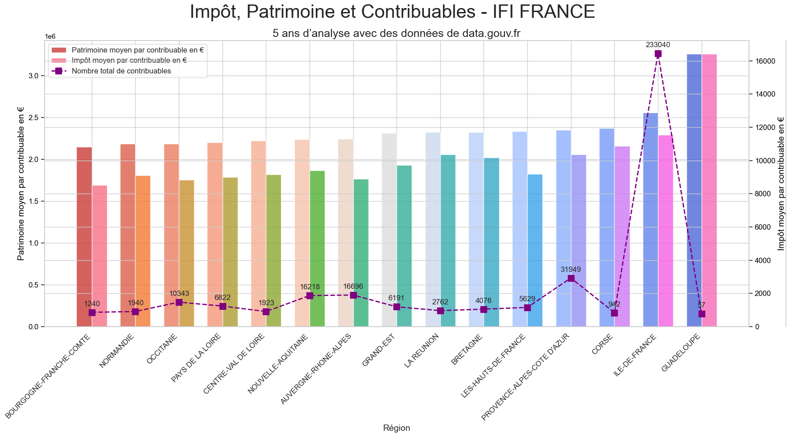

# French IFI tax: exploratory data analysis

An exploratory analysis of French municipal real-estate wealth-tax statistics. It covers data preparation, geographic joins, distributions, growth summaries and exports for Power BI.

## What is implemented

[Exploration notebook](Script/Exploration/Data%20Exploration%20and%20Initial%20Analysis.ipynb):

- Read and combine the bundled tax spreadsheets.
- Clean commune identifiers and join commune information.
- Explore taxpayer counts, average assets and average tax amounts.
- Produce charts, correlations and tables for geographic and year-by-year comparisons.
- Export analysis tables in `DataOut/` and dashboard inputs in `DataOut/PowerBI/`.

## Interpretation limits

These are aggregate tax statistics, not a census of household wealth. Coverage, missing records and filtering affect comparisons between communes and years. Correlations are descriptive, not causal. Normalized tables are visualization inputs, not euro-denominated values.

This repository is the exploratory stage of a three-part project. [Model comparison](https://github.com/santiagopatinoserna/TensorFlow_Prediction_5YearFrench_IFI) and [recursive projections](https://github.com/santiagopatinoserna/Prediction_5Years_IFITAX) live in separate repositories; their existence does not validate a forecast here.

## Reproduction notes

Open the notebook in Jupyter and adapt the hardcoded input/output paths to this checkout. Its imports include pandas, NumPy, matplotlib, seaborn and scikit-learn. Reading the bundled `.xls` and `.xlsx` files requires compatible Excel readers. There is no locked original environment, and installing current dependencies has not been tested as an end-to-end reproduction.

## Saved artifacts

- `DataOut/df_ificom.csv`: exported analysis table.
- `DataOut/PowerBI/df_base.csv`: base dashboard table.
- `DataOut/PowerBI/df_base_norm.csv`: normalized dashboard table.
- `DataOut/PowerBI/avg_growth_df.csv`: derived growth summaries.

These are saved outputs from the original analysis, not newly generated results.

## Project status

Historical exploratory work using the 2019 to 2022 IFI input files kept in `DataIn/`. This is a research notebook, not a deployed service. The notebooks and exported results have not been rerun end to end in the current environment.

## Data and reuse

The tax input files are attributed in the project notebooks to the French public dataset *Impôt de solidarité sur la fortune / Impôt sur la fortune immobilière par collectivité territoriale*. Commune coordinates and lookup tables are included in `DataIn/`. Source files and derived tables retain their applicable upstream terms; this repository does not grant a new licence over those datasets. Check the original publisher and the terms for each input before redistribution.

## Author

Santiago Patiño Serna. [LinkedIn](https://www.linkedin.com/in/santiago-patino/) · [Godi.AI](https://godi.ai).
